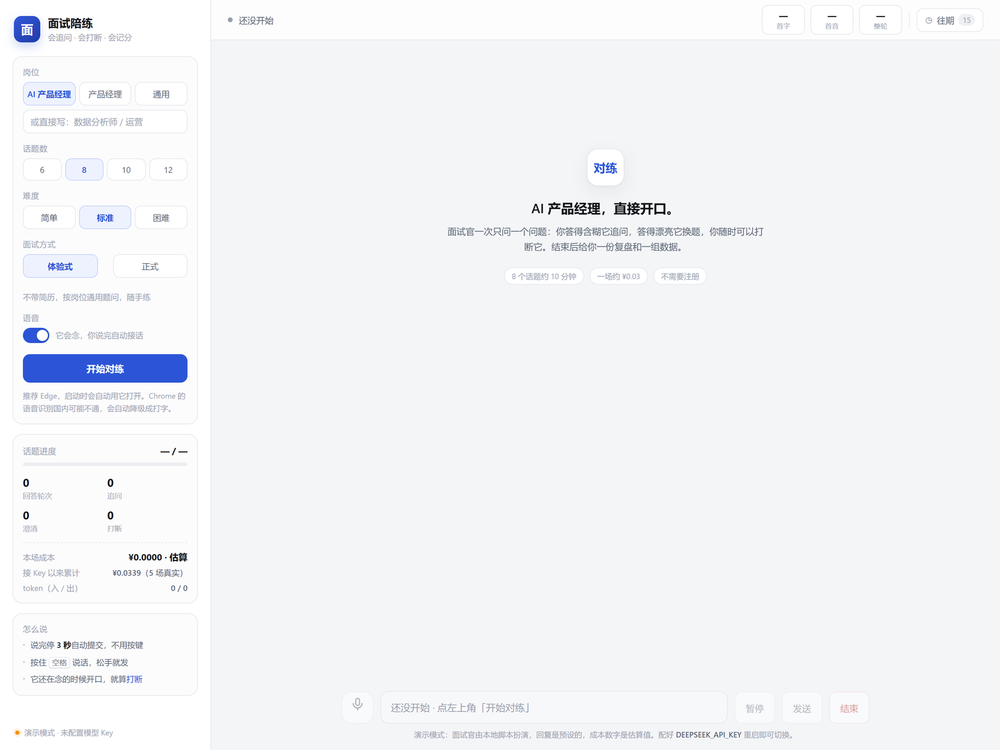
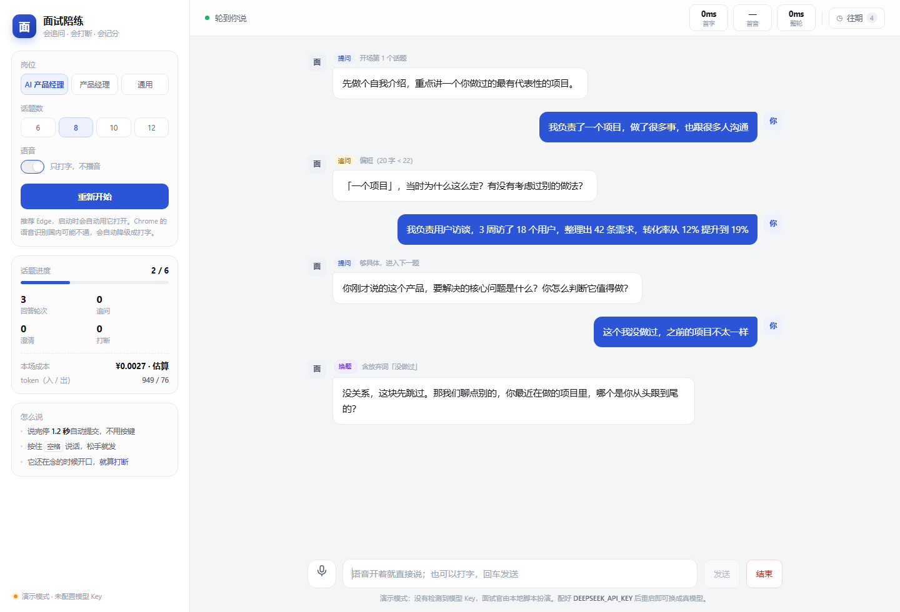

# 面试陪练 Agent

**把"面试练习"从对着镜子自说自话，变成有人会追问、会打断、会记分的对练。**

打开页面，选岗位，直接开口说话。Agent 像真面试官一样一次问一个问题：你答得含糊它追问，答得漂亮它换题，你随时可以打断它。结束后给一份复盘和一组数据。

- 零第三方依赖：`python server.py` 就能跑，不用 pip install
- 一场 8 个话题约 10 分钟、成本约 ¥0.05——**两个都是估算**，按官方价目算出来的，不是实测；M6 还是 0 场，实测数字等跑完 10 场再填（见第四、八节）
- 不注册、不建库、不上云，会话记录落在本地 `runs/`
- 每场结束自动落盘，右上角「往期」能翻回任何一场：分数、改进、完整对话

> **状态**：M1–M5 已完成，MVP 可跑通完整一场；M6（真实场景评测 10 场）**0 / 10**。代码链路自测全过，也接真模型跑过 5 场调试会话；但"好不好用"没有评测数据支撑——**本 README 里的成本数字全是估算，唯一一组实测延迟来自调试期样本，不能当结论**，第八节说清楚了。

<p align="center">
  
  
</p>

左：选岗位、话题数、语音或打字，点「开始对练」就能开口。
右：每个气泡都带动作标签——`提问` / `追问（偏短 20 字 < 22）` / `换题（含否决词「没做过」）`，判定由代码算，不调模型。

> 以上是演示模式截图（未配置 Key，面试官由本地脚本扮演，所以时延显示 0ms）。接上 Key 后界面不变，模型换成真实调用。

---

## 一、30 秒跑起来

**方式一：双击桌面上的「启动面试陪练Agent」**（等同于运行项目里的 `启动界面.bat`）。会弹出一个黑色窗口并自动打开浏览器，**关掉这个窗口 = 停止服务**。重复双击只会再开一次页面，不会起第二个服务。

**方式二：命令行**

```bash
cd 面试陪练Agent
python server.py            # 打开 http://127.0.0.1:8000
```

没配 Key 也能跑：会自动进**演示模式**，面试官由本地脚本扮演（回复是预设的，成本是估算值），用来验证交互和界面。

接真实模型只要一个 Key。最省事的是写进项目根目录的 `.env`（复制 `.env.example` 改一行），之后双击快捷方式就是真实模式：

```bash
# .env
DEEPSEEK_API_KEY=sk-xxxx
```

也支持临时用环境变量（优先级：系统环境变量 > `.env` > `config.json`）：

```bash
# Windows PowerShell
$env:DEEPSEEK_API_KEY="sk-xxxx"; python server.py

# macOS / Linux
DEEPSEEK_API_KEY=sk-xxxx python server.py
```

> 模型名默认 `deepseek-flash`。如果接口返回 model 不存在，把 `config.json` 的 `model` 改成 `deepseek-chat` 即可，价目档位不变。

配好 Key 后先跑一条命令确认通了，再去开麦：

```bash
python tools.py check
```

它依次做三件事：读 Key（并说明来自系统环境变量、`.env` 还是 `config.json`）→ 调 `/models` 校验模型名 → 发一轮真实对话，量出首字延迟和这一轮花了多少钱。退出码 `0` 可用、`1` 连不上或配错了、`2` 没找到 Key（这时就是演示模式）。报错会给出具体该改哪一项，不用猜。

**浏览器**：启动时会**自动用 Edge 打开**（Chrome 的语音识别走境外服务，国内经常连不上）。找不到 Edge 才退回系统默认浏览器；语音不通时会自动降级成打字，界面会说明原因。

其他参数：`--port 8123`、`--mock`（强制演示模式）、`--no-open`（不自动开浏览器）。

---

## 二、核心设计：动作由代码判，话由模型说

这是整个项目最关键的一个决定。

```
用户说完一句
     ↓
代码判定（不调模型，0 延迟 0 成本）
     ├── 识别为空 / 实字数 < 4        → 澄清：反问确认，话术是代码模板
     ├── 含「不知道 / 没做过 / 跳过」  → 换题：降到更基础的同类问题
     ├── 偏短（< 22 字）或没细节       → 追问：问具体做了什么、数据多少
     └── 够具体                      → 下一题
                              ↓
                     话题满 8 个 → 收尾 → 复盘
```

**为什么动作不交给模型判**：模型判动作要多输出几十个 token，首字延迟上升；而且判定规则不可解释、不可调。写进提示词只是建议，写进代码才是约束。

判定全部在 `agent.py: decide()`，是一个纯函数——输入文本和当前题状态，输出动作 + 原因。原因会显示在界面上（气泡上方的小字），所以每个"追问/换题"都是可解释的。

**每个动作都有上限**，否则候选人会被卡死在同一题：

| 参数 | 默认 | 作用 |
|---|---|---|
| `max_questions` | 8 | 一场几个话题 |
| `max_probe_per_question` | 2 | 一题最多追问几次，超了强制换题 |
| `max_clarify_per_question` | 2 | 一题最多澄清几次，超了改为追问 |
| `max_switch_per_question` | 2 | 一题最多换几次题，超了记为未答、进下一题 |
| `silence_seconds` | 5 | 轮到你说、却一直没开口，多久主动催一句 |
| `silence_close_seconds` | 5 | 催过之后还没动静，多久把这一场收掉（累计 10 秒） |

澄清 / 追问 / 换题**都不推进话题号**——所以"8 个话题"是真的 8 个话题，不是 8 句话。

**难度档**（侧栏可选）：简单 / 标准 / 困难。它只改三件事，**判定顺序一点没动**：

| 档位 | 短句阈值 | 细节要求 | 提问深度 |
|---|---|---|---|
| 简单 | 16 字 | 有数字**或**结果词就算 | 基础和经历类，允许展开讲 |
| 标准 | 22 字 | 同上 | 贴近真实面试，要做法和大致结果 |
| 困难 | 34 字 | **数字和结果词都要有** | 挖具体数据、权衡和失败案例 |

困难档是为了治一个实测问题：标准档下 6 个话题 0 次追问——因为回答里只要出现「30%」这类词就算"有细节"，字数够了就过。困难档要求「从多少到多少、影响了什么」都说清楚，否则追问。

**冷场分两段，而且不走判定树**：

1. 安静满 **5 秒** → 催一句「不着急，想到什么说什么」（模板，0 token）
2. 催完再等 **5 秒**（累计 10 秒）→ **收尾并结束本场**，自动弹复盘
3. 中间你一开口，计数清零；下次再安静，又从"催一句"开始

空文本要是走 `decide()`，会被判成"没听清"，连催两次就变成"麦克风坏了"——那是另一回事。

另外三处跟"人怎么用"有关的设定：

- **说完判定 3 秒**（`S.silenceMs`）：2 秒太急，话说一半想词儿就被当成说完了
- **麦克风是静音开关**：点一下关、再点一下开，不等于"我说完了"；点进输入框打字会顺手把麦克风关掉，离开自动接回
- **有暂停键**：思考、喝水、接电话时把整场冻住——暂停期间不识别、不播报、不提交、不催场，再按一下接着来

---

## 三、五个能力怎么做的

### 1. 打断即停

TTS 逐句播报时用 `utterance.onboundary` 记已播字符位置；用户开口（识别到 ≥4 个字，且不像外放回声）→ 立即 `speechSynthesis.cancel()`，本轮剩下的句子只出字幕、不再出声。

下一轮把"已播 42%、停在『…』、他插话说『…』"写进上下文。Agent 的行为是**停下来回应插话，不补念没说完的部分**——真人被打断也是停下听你说，倒回去补反而假。

为什么不接着断点说：试过，它会跟你正在说的话打架，而且"该从哪个字接"它判断不准。

度量：打断次数、平均打断位置、不重复率。不重复率是**代码粗判**（新回复有没有以被打断那段的前 12 字开头），非盲评。

### 2. 延迟预算

模型流式输出 + **分句播报**：凑满一句就先念，不等全文。句子切分不光看句号，逗号后超过 22 字也会切——首音能提前 1–2 秒，代价是语气有点断。

界面顶部实时显示三段：**首字 / 首音 / 整轮**（都是"你说完"到该节点的耗时），超 800ms / 1.5s 会变黄。结束出 P50 / P95。

### 3. 澄清策略

双层：代码层拦空/过短输入（直接反问，**不发给模型**，省钱且防幻觉）；模型层只负责把话说得自然——本实现里连话术都是代码模板，所以澄清轮 **0 token**。

度量：澄清触发率 = 澄清轮数 / 总轮数，目标 10%–20%。过高说明识别或引导有问题。

### 4. 失败兜底

| 故障 | 兜底 |
|---|---|
| 浏览器不支持语音识别 | 自动降级文字，界面说明原因 |
| 语音识别返回空 | 反问"没听清，再说一遍"，不调模型 |
| 模型超时 / 报错 | 说一句兜底话术，会话不中断；同时把报错归类（Key 失效 / 欠费 / 模型名 / 限流 / 超时 / 网络），在提示条给出该改哪一项 |
| 模型返回空 | 同上报错兜底：字幕和播报都有内容，不会只剩一个空气泡 |
| 网络断 | 本地服务保留会话，每轮已落盘，恢复后能接着聊 |

### 5. 复盘：不只说哪里不行，还给出"可以怎么答"

只讲"你没给数据"是没用的——得让他看到一条**能照着学的答法**。所以复盘里每一题都给三行：

- **他问的**（原话）
- **你当时答的**（原话，方便对照）
- **可以这样答**：候选人第一人称、2–3 句，**必须带一个具体数字或一个真实例子**（比如「把评测集从 20 条扩到 200 条，bad case 从 31% 降到 12%」），不是"要有数据支撑"这种空话

默认收起，点「看参考答法」才展开——不然复盘会长得看不下去。

演示模式下这一项**不生成**，界面直接写「演示模式不生成参考答法」：没有模型可问，就不假装懂内容。

### 6. 简历模式：可开可关

首页有一个「面试方式」开关，默认关着——按岗位通用提问。打开后可以选 `.docx` / `.txt` / `.md`，或者直接把简历正文粘进来，面试官会从简历里挑一个项目开场，并追着简历上的数字问。

- **只认文字层**：不硬解析 PDF（中文 PDF 要字体映射表，标准库做不到，引第三方库又违背零依赖），会直接告诉你「另存为 .docx」或「把文字粘进来」
- **原文不落盘**：`runs/` 里只记文件名、字数、有没有用简历；正文只在内存里，会话结束就没了。但要说清楚——**提问时它会作为提示词发给模型**，和你的对话内容走同一条 API，不是纯本地处理
- **不改判定逻辑**：简历只影响系统提示词和第一句开场，`decide()` 的追问 / 澄清 / 换题规则一行没动

---

## 四、成本

单价按 DeepSeek 官方人民币价目（`deepseek-flash`，2026-11 核对）：**输入 ¥2 / 百万 token（缓存命中 ¥0.04）、输出 ¥8**。官方分时段：北京时间**工作日 9:00–12:00、14:00–18:00 是高峰**，其余（午休、晚上、周末、法定节假日）**半价**。`agent.py` 的 `is_peak()` 按这个规则自动切换，所以晚上练显示的成本是白天的六折左右。

一次 12 轮对练 + 1 次复盘，预估约 15.9K 输入 + 1.34K 输出（未计缓存命中，实际会略低）：

| 项 | 单价 | 单次用量 | 单次成本 |
|---|---|---|---|
| 模型输入 | ¥2 / 百万 | 15.9K | ¥0.032 |
| 模型输出 | ¥8 / 百万 | 1.34K | ¥0.011 |
| 语音识别 | 浏览器内置 | — | ¥0 |
| 语音播报 | 系统内置 | — | ¥0 |
| 服务器 | 本地跑 | — | ¥0 |
| **合计（高峰）** | | | **≈ ¥0.043** |
| **合计（空闲）** | 半价 | | **≈ ¥0.021** |

**练 20 场约 1 块钱。**

口径说明：上面是估算，浮动 ±30%。产品里**会**按接口返回的 `prompt_tokens / completion_tokens / prompt_cache_hit_tokens` 逐轮累加，并按上面高峰/空闲的规则计价，侧栏和复盘里显示的是实付口径；只有接口没返回 usage 时才退回估算，并在报告里标注 `estimated`。

节假日按工作日算——本地没有中国节假日日历，所以法定假日那几天会略有高估（宁可多报不少报）。

但要说清楚：**M6 还是 0 场。** 调试期用真模型跑过 5 场（累计 ¥0.0339、26 轮计时），但那些场次话题都没走完，是调界面、修 bug 留下的，不算评测样本。所以上面整张表仍是估算值。等 10 场跑完，`python tools.py summary` 会把实测的 P50 和成本摊出来，那时再把数字换进去。

如果浏览器语音不通、改接云端语音：实时识别约 ¥2/小时、播报约 ¥0.25/万字，单次变成 ≈ ¥0.6，20 场约 ¥12，仍然便宜。

---

## 五、目录

```
面试陪练Agent/
├─ server.py          本地服务（纯标准库）：流式 NDJSON、静态资源、会话管理
├─ agent.py           对话引擎：状态机 · 动作判定 · DeepSeek 流式 · 指标与成本 · 复盘
├─ config.json        全部可调参数（轮数、阈值、价目、岗位）
├─ web/
│  ├─ index.html      界面结构
│  ├─ style.css       样式
│  └─ app.js          语音识别 / 分句播报 / 打断 / 计时 / 复盘渲染
├─ selftest.py        链路自测：六层（规则 / 会话 / HTTP / 接口 / 兜底 / 简历）
├─ tools.py           运维命令：check（验真实模式）· summary（汇总评测）
├─ dev/
│  └─ asr-stub-test.js  语音状态机桩测试（可选，需要 node，不用麦克风）
├─ runs/              每场会话：session.json + report.md + report.json
├─ eval/              自测报告与界面截图
└─ LICENSE            MIT
```

两条运维命令都不参与网页运行时：

| 命令 | 作用 |
|---|---|
| `python tools.py check` | 验 Key、验模型名、量真实一轮的首字延迟与花费 |
| `python tools.py summary` | 汇总 `runs/`，出评测表；加 `--write` 写进 `eval/` |

历史接口（普通 JSON）：`GET /api/history` 列表、`GET /api/history?id=<目录名>` 单场复盘 + 完整对话。

接口（都用 NDJSON 流式返回）：

| 接口 | 作用 |
|---|---|
| `POST /api/session/start` | 开局，返回第一句 |
| `POST /api/turn` | 提交一轮，流式返回 meta / tok / sent / usage / done |
| `POST /api/interrupt` | 记录打断（位置、已播文本、用户插话） |
| `POST /api/timing` | 回传三段耗时 |
| `POST /api/report` | 生成复盘并落盘 |
| `GET /api/health` | 模式与配置 |

---

## 六、自测

```bash
python selftest.py            # 六层，约 45 秒
```

产出 `eval/自测-YYYYmmdd-HHMM.md`，包含：

1. **判定规则单测**：9 个用例，覆盖四种动作和三个上限（当前 9/9）
2. **10 场模拟会话**：四种候选人（认真型 / 含糊型 / 放弃型 / 一半一半）轮换，验证状态机能走满 8 个话题、不会死循环、打断上下文真的注入了
3. **HTTP 端到端**：真起服务，用 ndjson 流跑一遍，确认前后端契约对得上
4. **模型接口契约**：本地桩模拟 DeepSeek 的 SSE，验流式解析、缓存计价、指令注入，不需要真 Key
5. **兜底路径**：接口 401 / 402、模型返回空，三种情况下气泡都还得有字——「漏发 `tok` 变空气泡」这个 bug 已经复发过三次，专门用一层测试盯住它
6. **简历模式**：现场造一个 `.docx` 验解析、简历有没有进提示词、开场有没有换指令、关掉能不能回退（当前 5/5）

**这份报告证明的是"链路跑通"，不是"效果好不好"。** 它用的是演示模型，延迟和成本都是链路证据，不是产品指标。

自测产生的假会话写在系统临时目录、跑完即删，所以 `runs/` 里出现的每一条都是真练出来的——不然「往期复盘」和评测汇总会被自测数据污染。

**语音状态机另有一层桩测试**（可选，需要 node，不需要麦克风、不起服务）：

```bash
node dev/asr-stub-test.js
```

它用假的 `SpeechRecognition` / `speechSynthesis` / `fetch` 跑真实的状态机，验证「开局开麦、识别假活能被心跳救回来、说完一轮麦克风能自己接上、开场耗时从点开始算起」。语音这块历史上 9 个 bug 里占 6 个，以前只能真开麦试，这层测试就是补这个窟窿。node 只是开发时用，`python server.py` 依赖的仍然只有标准库。

---

## 七、里程碑对照

| 阶段 | 内容 | 状态 |
|---|---|---|
| M1 | 服务骨架 + 流式对话 | ✅ |
| M2 | 状态机 + 四种动作判定 | ✅（含三个上限，防死循环） |
| M3 | 语音接入 + 分句播报 | ✅（Edge 上验证过识别与播报；Chrome 国内可能不通） |
| M4 | 打断即停 | ✅（识别出 ≥4 个字才算打断；播报开头 500ms 与两次打断之间 2s 有保护期，避开外放自激；停下后不补念） |
| M5 | 指标面板 + 复盘 + 成本统计 | ✅ |
| M6 | 自己跑 10 场出评测 | ⏳ 链路自测已跑 10 场；**真实 10 场要接上 Key 自己练** |

M6 待办（接上 Key 后）：

1. `python tools.py check` —— 先确认 Key、模型名、首字延迟都正常，再开麦
2. 用 `python server.py` 起服务，戴耳机，按 8 个话题练 10 场
3. 每场结束把 `runs/<时间戳>/report.md` 收好，或直接跑 `python tools.py summary --write` 生成汇总表
4. 表里缺的只有主观评分和观察，补上；只写观察到的，不写猜的——样本量是 1，本来就不该下泛化结论

---

## 八、边界与诚实声明

- **还没有评测级数据**：M6 是 0 / 10。调试期跑过 5 场真实会话（26 轮），实测首字 P50 755 ms、首音 P50 1035 ms，但那几场话题没走完、属于修 bug 期间的样本，只用来确认链路和统计口径，**不能当效果结论**。README 里的成本表仍是估算，不是实测
- 评分是模型自评，**非盲评**，不能当客观指标用
- 只有作者一个用户，样本量为 1，不主张泛化结论
- 语音识别准确率受浏览器与网络影响，不是本项目的优化目标
- **简历模式只读文字层**：扫描件、图片型简历、PDF 都读不出内容，会提示你另存为 `.docx` 或粘贴文字
- 不做真人面试的替代品，定位是"高频低成本的练习工具"
- `eval/*.png` 是界面预览，用录下来的真实会话事件回放渲染，不是手画的示意图

---

## 九、和策划书的差异

只加了一处，其余按策划书默认值实现（8 个话题、每题最多追问 2 次、价目与汇率不变）：

- 新增 `max_switch_per_question: 2`。原因是测试时发现：候选人一直说"不知道"时，换题不推进话题号，会被卡在同一题上无限换题（自测里跑到 60 轮才发现）。真实面试官问两次没反应也会往下走，所以加了上限。

另外两处实现细节：

- 澄清话术用代码模板而不是模型生成，让澄清轮真正 0 token（策划书原文是"模型层负责把反问说得自然"，这里选择了更省的做法，代价是话术有重复感）
- 复盘只生成一次并缓存，避免"点两次下载"重复计费

---

## 十、三句话讲清这个项目

> 1. 我做了两个单轮的工作流 Agent，发现作品集缺"交互态"，所以做了第三个：能被打断的多轮语音对练。
> 2. 这个项目里我真正解决的是三件事：打断怎么停得干净、首音怎么从"等全文"压到"一句就念"、什么情况该反问而不是猜。
> 3. 我把动作判定放在代码里而不是提示词里，因为写进提示词只是建议，写进代码才是约束。

三个最容易被问到的问题，答案都在代码里：

- **"你怎么保证 8 个话题是真的 8 个话题？"** → 追问、澄清、换题都不推进话题号，只有"够具体"才推进，且每种动作都有次数上限。
- **"打断之后它会怎么样？"** → 立刻停，不补念；下一轮把已播比例、停在哪儿、你插了什么注入上下文。有一个代码粗判的"不重复率"，承认非盲评。
- **"5 分钱是怎么算的？"** → 按官方价目算的：产品按接口返回的 token 逐轮累加，接口没给就退回估算并标注。但要说实话——**M6 是 0 场，这个数字仍是估算**。调试期 5 场真实会话实付 ¥0.0339，可那几场话题没走完，不能直接折算成整场成本。

---

## 许可

MIT，见 [LICENSE](LICENSE)。
