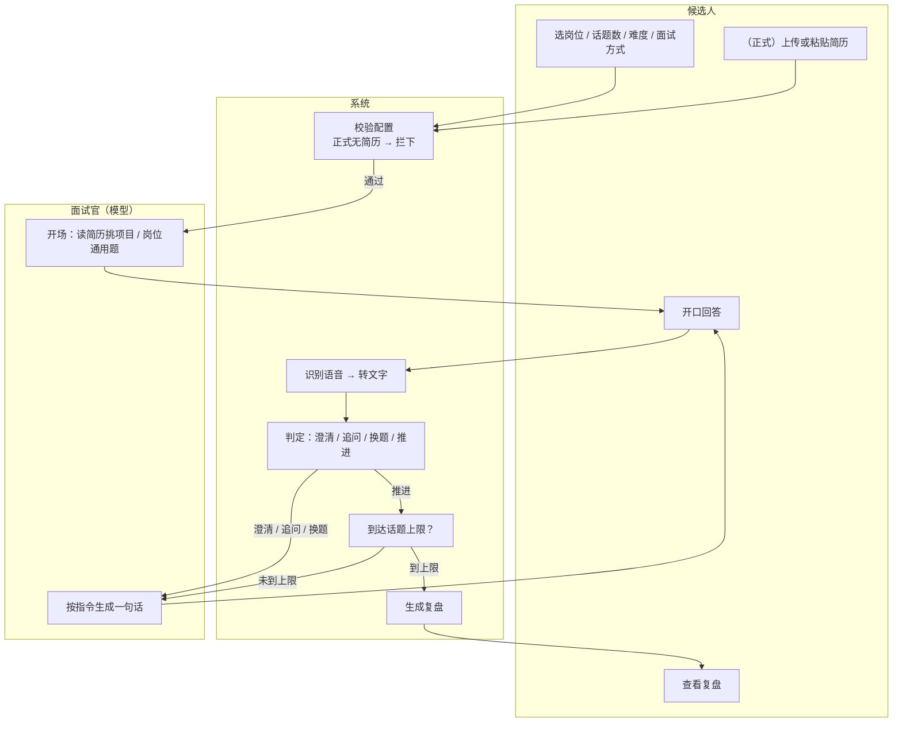

# 面试陪练 Agent · 需求说明书（PRD）

| | |
|---|---|
| 版本 | v1.0 |
| 日期 | 2026-11-08 |
| 作者 | 〈填你的名字〉 |
| 状态 | 已上线（本地版），M6 评测进行中 |
| 关联文档 | `01-需求树.md`、`04-可点击原型.html`、`03-验收测试报告.md` |

---

## 一、背景与目标

### 1.1 为什么做

准备面试的人不缺题，缺**开口的机会**和**有人告诉他哪里答得不对**。

- 真人模拟面试：¥300–800 / 小时，约人、约时间都麻烦，一场只能覆盖一家公司；
- 对着镜子练：没有追问，练的是背稿，不是应答；
- 刷题库：知道"该说什么"，但不知道"说得够不够具体"——真实面试里被杀掉的往往是"数据说不清"，不是"不会答"。

AI 产品岗的面试尤其如此：面试官会追着你简历上的一个数字问三层，答不上来就判定"这段经历是包装的"。**这种追问压力，只能靠反复被追问来练。**

### 1.2 目标

让候选人在 **10 分钟内**完成一场 8 个话题的多轮语音面试，结束后拿到**一份能照着改的复盘**，单场成本控制在 **5 分钱以内**。

### 1.3 成功指标

| 指标 | 定义 | 目标值 | 现状 |
|---|---|---|---|
| 完成率 | 走完全部话题的场次 / 开场场次 | ≥ 80% | M6 评测中（0/10） |
| 追问有效性 | 追问中带具体指向（数字 / 动作 / 时间）的比例 | ≥ 70% | 人工抽检，M6 一并统计 |
| 单场成本 | 一场 8 话题的模型调用费用 | ≤ ¥0.05 | 实测 6 话题 ¥0.013（半价）/ ¥0.026（全价） |
| 首音延迟 | 候选人说完 → 面试官开口 | ≤ 1.5 秒 | 调试期实测 P50 1.03 秒（非评测样本） |

> 说明：完成率与追问有效性是**目标值**，要等 M6 十场真实对练跑完才有实测数字。工程上已经能跑通，但"好不好用"还没有数据支撑——这一点在验收测试报告里也写明了。

---

## 二、用户与场景

### 2.1 目标用户

求职 AI 产品经理 / 产品经理实习的在校生与转岗者。特征是：**有时间、缺机会、预算低**，且投递量大（一家公司一场面试，需要反复练）。

### 2.2 用户故事

**故事一（体验式，练表达）**
> 我明天要面一家 AI 公司，不知道会被问什么。我想先随便打一场，看看自己一开口是不是又在背概念。
>
> —— 打开就点开始，不问岗位以外的任何信息；8 个话题打完，复盘告诉我"你有 4 次回答没给数字"。

**故事二（正式，练简历）**
> 我简历上写了"日活 400"，我怕被追问。我想让面试官就盯着我简历问。
>
> —— 上传简历 → 面试官开场就问"这个 400 是怎么统计的"；我含糊过去，它追到"哪个后台、打开算还是登录算"。

### 2.3 不做谁

不做社招高级岗的深度面（需要行业 know-how，模型给不出可信的深度追问）；不做群面、不做英文面。

---

## 三、功能需求清单

| 编号 | 功能点 | 优先级 | 描述 | 验收标准 |
|---|---|---|---|---|
| F01 | 岗位选择 | P0 | 「通用岗位」一个预设 + 手写输入框 + 历史岗位（本地 8 条） | 输入框有内容时「通用岗位」取消高亮、删空再亮回；点「通用岗位」清空输入框；标题即时变成"〈岗位〉，直接开口"；开过一场后，写过的岗位出现在「历史」里 |
| F02 | 自定义岗位 | P0 | 手写岗位名，模型按该岗位真实会问的出题 | 输入"数据分析师"，首句问的是数据分析岗会问的题（如"从拿到需求到给出结论怎么走"）；限 16 字，换行被清洗，洗空退回通用 |
| F03 | 话题数 | P0 | 6 / 8 / 10 / 12，默认 8 | 达到上限自动收尾并生成复盘；6 话题实测 11–15 轮、5–13 分钟 |
| F04 | 难度 | P1 | 简单 / 标准 / 困难 | 只改短句阈值（16/22/34 字）、是否强制"数字+结果"、提问深度；判定顺序不变 |
| F05 | 面试方式 | P0 | 体验式（不带简历）/ 正式（必须给简历） | 只选体验式时，提示词里明写"本场没有简历，不要提简历"；选正式未给简历 → 前端拦住 + 服务端 HTTP 400 带人话提示，不静默降级 |
| F06 | 简历导入 | P0 | .docx / .pdf / .txt / .md 或粘贴正文 | 3 段 docx 解析出正文字数且保留段落；带文字层的 PDF 能读出中文正文（含 Identity-H 字体）；扫描件 / 图片型 PDF 明确提示"另存为 docx 或粘贴"；正文不落盘，只记文件名与字数 |
| F07 | 开场提问 | P0 | 一句话，正式模式必须从简历挑项目 | 体验式首句是提问（祈使句可接受）；正式模式开场引用简历里的项目名或数字 |
| F08 | 追问 | P0 | 回答偏短或无细节时，就其中一处追问 | 19 字回答触发追问；追问必须指向具体动作或数字，不许重复原问题 |
| F09 | 澄清 | P0 | 识别为空 / 实字数 < 4 时请对方重说 | 输入"嗯"→ 澄清；澄清必须同时出字幕（不是只有语音） |
| F10 | 换题 | P0 | 命中放弃词且整句就是在说不会 → 换更基础的同类问题 | 连续答"不知道"时逐次换题，不得把同一题重复问第二遍 |
| F11 | 动作上限 | P0 | 每题追问 / 澄清 / 换题各最多 2 次 | 连续 4 次"不知道"后必须推进到下一话题，不得卡死 |
| F12 | 语音识别 | P0 | Web Speech，边说边出字，断线自愈 | 断线后 30 秒内自动重连；重连不清空已识别文字；点一次麦克风可立即重连 |
| F13 | 播报与打断 | P0 | 按句念，可打断 | 播报中说话 → 立即停；打断后本轮作废，只出字幕不出声；外放不得自己打断自己 |
| F14 | 冷场提交 | P1 | 说完 4.5 秒无输入自动提交 | 不打断思考；播报或生成结束时重新计时，不吞掉用户在这期间说的话 |
| F15 | 复盘 | P0 | 结束后自动生成并弹窗 | 含总分、总评、3 条优势、3 条改进；优势必须引用原话 |
| F16 | 逐题复盘 | P0 | 每题四条：点评 / 思路 / 该备的数 / 参考答法 | 范本 60–90 字、第一人称、含至少一个具体数字；模型返回不完整时明确说"这次没有范本"，不假装有 |
| F17 | 成本统计 | P1 | 逐轮累加 token，分时段计价 | 页面显示本场花费与累计花费；演示模式不计入累计（那是估算，不是真花钱） |
| F18 | 往期记录 | P1 | 历史场次可回看 | 列出历史场次，可打开复盘；显示岗位、方式、话题数、花费 |

---

## 四、流程与边界规则

### 4.1 主流程（泳道图）

### 4.2 判定顺序（改一行就会改产品行为）

| 顺序 | 条件 | 动作 | 为什么排在这 |
|---|---|---|---|
| 1 | 识别为空 或 实字数 = 0 | 澄清 | 没听见 ≠ 答得差，先请对方重说 |
| 2 | 命中放弃词，且放弃词占全文 1/4 以上，或整句很短又没有细节 | 换题 | "不知道"只有 3 个字，但语义明确，该换题不是该反问 |
| 3 | 实字数 < 4 | 澄清 | 语气词当没说清处理 |
| 4 | 本题追问已达 2 次 | 推进 | 到上限必须走，不能把人钉死 |
| 5 | 实字数 < 22（困难档 34） | 追问 | 偏短 = 没展开 |
| 6 | 没有数字也没有结果（困难档要求两者都有） | 追问 | "有内容没细节"是面试最常见的失分点 |
| 7 | 其他 | 推进 | 够具体，换话题 |

> 放弃词判定有个坑：用户说 200 多字、中间顺嘴一句"不知道从何下手"，早期版本直接换题了。所以加了"占全文 1/4"这个约束——**判断词义要看它在这句话里的权重，不能只看有没有出现**。

### 4.3 异常清单

| 异常 | 表现 | 处理 | 依据 |
|---|---|---|---|
| 无网络（识别） | 说半天不出字 | 保留语音，退避重连（4/7/12/20/30 秒），不降级 | 在线识别断线是常态，不该判死刑 |
| 无权限（麦克风） | 一开始就不出字 | 降级打字，播报继续，提示怎么开权限 | 识别不可用 ≠ 不能听它说话 |
| 识别为空 | 提交上来 0 字 | 澄清，不记作答 | 统计口径上不能算候选人答了 |
| 引擎假活 | 麦克风开着、零事件 | 心跳每 12 秒换新识别器；用户点一下也立即重连 | onend 不 fire，只能靠心跳 |
| 重复提交 | 同一轮发两次 | 页面端提交即置灰；服务端无幂等键（已知缺陷 BUG-02） | 单机单用户，代价 ¥0.002，暂不修 |
| 超长输入 | 一次说 500+ 字 | 正常判定，不截断；模型侧只取最近 30 轮 | 宁可多收，不可丢内容 |
| 模型超时 / 报错 | 半天不开口 | 提示"连不上模型"，允许重试；不静默换模板 | 静默降级会让人以为模型就这水平 |
| 模型输出不完整 | 复盘缺字段 | 明确提示"这次没有范本"，不编造 | 宁可承认缺，不可假装有 |
| 冷场 | 一直不说话 | 先催一句，再无回应换更基础问法 | 真人面试官不会干等 |

---

## 五、页面与交互

### 5.1 三个页面

| 页面 | 主要元素 | 关键交互 |
|---|---|---|
| 首页 / 空状态 | 岗位、话题数、难度、面试方式、开始按钮 | 选完即时反馈；正式模式才展开简历区 |
| 对练中 | 对话流、麦克风、HUD（话题进度 / 追问次数 / 花费）、提前结束 | 说话即答，可打断播报；随时切打字 |
| 复盘弹窗 | 总分、总评、优势、改进、逐题四件套、下载 | 逐题可展开看范本；下载 .md |

### 5.2 每页四种状态

| 页面 | 加载中 | 空 | 正常 | 报错 |
|---|---|---|---|---|
| 首页 | 不涉及（本地静态） | 未开始时显示"〈岗位〉，直接开口"引导 | 配置就绪，按钮可点 | 服务未启动 → "连不上本地服务" |
| 对练中 | 面试官思考中（三点动画） | 尚未开口 → "轮到你说" | 对话流滚动，HUD 更新 | 模型报错 → 提示可重试，不静默降级 |
| 复盘 | "面试官在整理复盘，稍等几秒" | 演示模式 / 模型失败 → 说明原因 | 完整五段 | 复盘失败 → 提示记录已存 runs/ |

### 5.3 一条交互铁律

**任何自动行为都必须可被用户打断。** 播报可打断、生成可打断、冷场计时会因为打字而重置。产品是陪练，不是播放器。

---

## 附：需求变更记录

| 日期 | 变更 | 原因 |
|---|---|---|
| 2026-10-31 | 首版：8 话题、三档难度、判定树、"打断恢复" | MVP |
| 2026-11-01 | "打断恢复"改为"打断即停" | 实测打断后补念反而让人以为它没听懂；且补偿性复述会污染下一轮上下文 |
| 2026-11-03 | 岗位加自定义输入；面试方式拆成体验式 / 正式 | "按简历提问"开关的文案贴在岗位下面，让用户以为岗位按钮不管用；且开关只有开/关，表达不出"正式面试"和"随手练"是两回事 |
| 2026-11-08 | 识别假活时点一次麦克风即重连 | 原来第一下是关麦，用户要点两次，看起来像"点了没用" |
| 2026-11-08 | 岗位预设收敛为「通用岗位」+ 手写，新增历史岗位；简历支持 PDF | 预设 AI产品经理/产品经理 是产品经理专用，面运营、数据分析的人反而被这两个按钮占位；PDF 是简历最常用的格式，让用户先另存为 docx 是无谓的门槛 |
